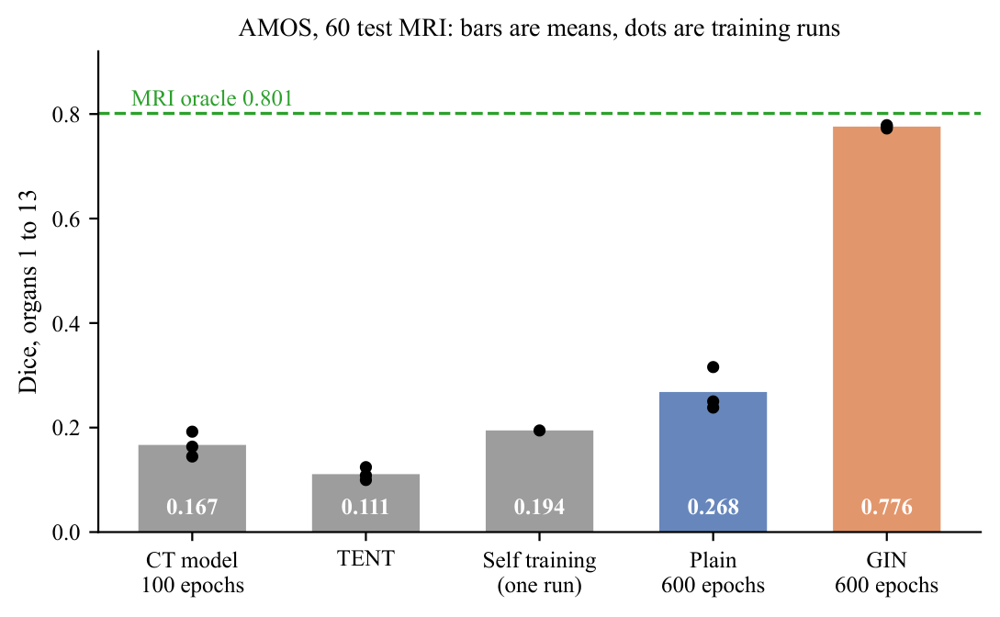
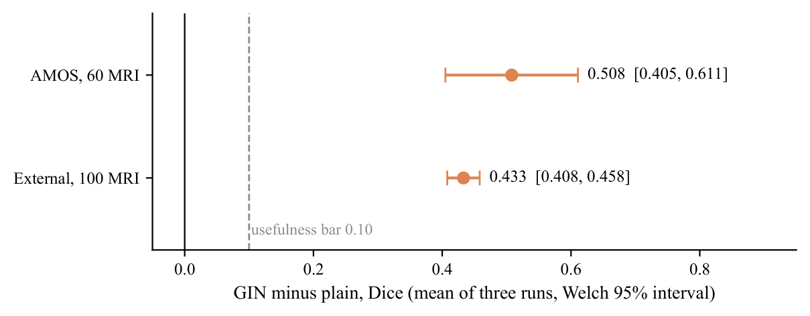
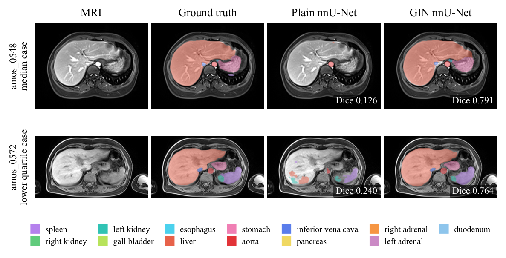

# Closing the CT to MRI gap in 3D abdominal organ segmentation

**Case study: unsupervised adaptation versus single source domain generalization, without any MRI labels**

Abu Ahmad · CSE498R research project, North South University · Supervisor: Dr. Mohammad Monir Uddin · 2026

**[Open the interactive results page](https://abuahmad369.github.io/Case-Study-of-Unsupervised-Domain-Adaptaion-from-CT-to-MRI-for-3D-abdominal-organ-segmentation/)**

Hospitals have far more labelled CT scans than labelled MRI. This project asks
whether a 3D segmentation model trained only on labelled CT can find 13
abdominal organs on MRI. A standard nnU-Net trained on CT scores 0.17 Dice on
MRI, while the same network trained on labelled MRI scores 0.80. I tested two
ways to adapt the CT model with unlabelled MRI, and both failed. Training with
random intensity augmentation (GIN) instead raised MRI accuracy from **0.268 to
0.776 Dice**, and from **0.073 to 0.506** on 100 MRI scans from an independent
dataset, at a cost of only 0.006 Dice on CT.

> The source code is private while a paper on this work is in preparation. This
> page documents the problem, the method and every result. All numbers are
> measured; none are estimated.

| | |
|---|---|
| [Interactive results](https://abuahmad369.github.io/Case-Study-of-Unsupervised-Domain-Adaptaion-from-CT-to-MRI-for-3D-abdominal-organ-segmentation/) | every model on both MRI sets, the tests fixed before training, every organ |
| [Method](docs/METHOD.md) | data preparation, the three methods, training, evaluation rules, engineering |
| [Results](docs/RESULTS.md) | every model and run, results per organ, all figures |

## Results at a glance

Mean Dice over 13 organs. Each plain and GIN number is the mean of three
independent training runs.

| Model, trained on labelled CT only | AMOS, 60 test MRI | External, 100 MRI | CT, 30 validation scans |
|---|---|---|---|
| nnU-Net, 100 epochs (mean of 3 runs) | 0.167 | | 0.825 |
| TENT on those models | 0.111 | | |
| Class balanced self training (1 run) | 0.194 | | 0.800 |
| nnU-Net, 600 epochs ("plain") | 0.268 | 0.073 | 0.851 |
| **nnU-Net with GIN, 600 epochs** | **0.776** | **0.506** | 0.845 |
| nnU-Net trained on labelled MRI (reference) | 0.801 | | |

On AMOS, GIN's gain is +0.508 Dice (Welch 95% interval 0.405 to 0.611), equal to
80% of the CT to MRI gap, and it ends 0.025 below the model trained on labelled
MRI. On the external set the gain is +0.433 (0.408 to 0.458). Every pass mark
was fixed in tested code before training began, and all of them passed.

## What I did

**Part A: adapt a CT model after training.** I trained three nnU-Net models on
CT and adapted each with 40 unlabelled MRI scans, using two published methods:

* **TENT** (test time entropy minimization) tunes the normalization layers so
  the model becomes more confident on MRI. With no labels to anchor it, the
  most confident answer is "no organ here", and it drifted toward predicting
  background. It lowered Dice in all three repeats and lost on all 60 test
  scans each time.
* **Class balanced self training** lets the CT model label the 40 MRI and
  trains a new model on its most confident answers. A quality gate I wrote in
  advance rejected two of the three teachers, and the one student that trained
  changed MRI Dice by +0.002, inside run to run noise.

The lesson: a model that scores 0.17 on MRI is too weak to learn from its own
guesses.

**Part B: train the CT model to ignore CT contrast.** GIN (Ouyang et al., 2023)
passes every training patch through a freshly drawn random shallow network
that remaps its intensities, sometimes mildly and sometimes into a negative,
while shapes and positions stay the same. The network cannot rely on how bright
an organ looks on CT and has to learn anatomy, which is what CT and MRI share.
I trained two arms of three runs each, plain and GIN, identical except for GIN,
and tested them once on the 60 AMOS test MRI and on 100 scans from
TotalSegmentator MRI that played no part in choosing the method.

## How the result was protected

* **Rules before results.** Thresholds, verdict labels and the analysis were
  committed to version control before any model they judge existed: a gain
  must reach 0.10 Dice with its 95% interval above zero, and CT may lose at
  most 0.03.
* **Repeats.** Three independent training runs per arm, compared with a Welch
  interval over run means, so one lucky run cannot carry the result.
* **A held out test set, read once.** The 60 test MRI were never used to choose
  or tune anything; the 40 unlabelled MRI were the only MRI any adaptation saw.
* **An independent test set.** 100 MRI from a different dataset, selected by a
  seeded rule fixed before download.
* **A fair organ set.** MRI labels the bladder and prostate in only 2 of 60
  scans, so every cross modality number uses the 13 organs both sides share,
  and an organ is scored on a scan only when its ground truth contains it.
* **Verifiable artifacts.** Every exported model and result file carries a
  SHA256 manifest written on the GPU machine, and every training session
  recorded a hash of the code it ran.

## Engineering highlights

* **Long training inside 12 hour sessions.** A 600 epoch run takes about 35
  hours on a T4 GPU. I extended nnU-Net's trainer to estimate before each epoch
  whether it, and the final validation, still fit the session; if not, it
  saves a checkpoint and exits, and the next session resumes with no epoch
  repeated or skipped (tested against the real nnU-Net code).
* **Paired training on two GPUs.** Each plain run and its GIN twin trained side
  by side on the two T4 GPUs of one session, so both always saw the same
  hardware and data.
* **Data preparation under a disk limit.** nnU-Net's default plan needed about
  30 GB against roughly 20 GB of writable disk. I fixed the voxel spacing at
  5.0 × 0.843 × 0.843 mm, keeping the native slice spacing, which brought the
  150 CT to 9.32 GB without dropping a single scan.
* **A silent orientation bug, caught before it cost anything.** AMOS stores CT
  and MRI with opposite left to right orientation, and nnU-Net's default reader
  ignores it, so CT and MRI would have been mirror images of each other while
  every score still looked plausible. An anatomy check caught it; the fix was
  nnU-Net's reorienting reader for both modalities.
* **Notebooks generated from tested source.** Every GPU notebook was generated
  from Python modules with their own self tests, and its cells were executed
  offline against fixtures with planted answers before any GPU time was spent.
* **A demo app for the faculty.** A local web app shows the results, runs both
  models on any MRI on a laptop GPU, and checks the evidence again on demand:
  model hashes, the result export, code identity, and the verdict recomputed
  from the raw scores.

## Tech stack

Python · PyTorch · nnU-Net v2 (2.8.1) · NumPy · NiBabel · Matplotlib ·
Kaggle notebooks on NVIDIA T4 GPUs · FastAPI for the demo app · Git

## Data and credits

* **AMOS** (Ji et al., NeurIPS 2022), CC BY 4.0, with the CT to MRI split of
  **M3DA** (Shirokikh et al., 2025): 150 labelled CT, 40 unlabelled MRI, 60
  labelled test MRI. The images on this page come from AMOS.
* **TotalSegmentator MRI** (Akinci D'Antonoli et al., Radiology 2025), CC
  BY-NC-SA 2.0, used for the external test set.
* **nnU-Net** (Isensee et al., Nature Methods 2021), **GIN** (Ouyang et al.,
  IEEE TMI 2023) as integrated in nnU-Net by **DG-TTA** (Weihsbach et al.,
  2023), **TENT** (Wang et al., ICLR 2021) and **class balanced self training**
  (Zou et al., ECCV 2018).

## Related

My earlier CSE499B project, a relational graph neural network for domain
adaptation across MRI scanners:
[GNN-UDA-in-3D-Medical-Image-Segmentation](https://github.com/abuahmad369/GNN-UDA-in-3D-Medical-Image-Segmentation)

Copyright 2026 Abu Ahmad. All rights reserved. The text and figures on this
page may not be reused without permission while the paper is in preparation.
