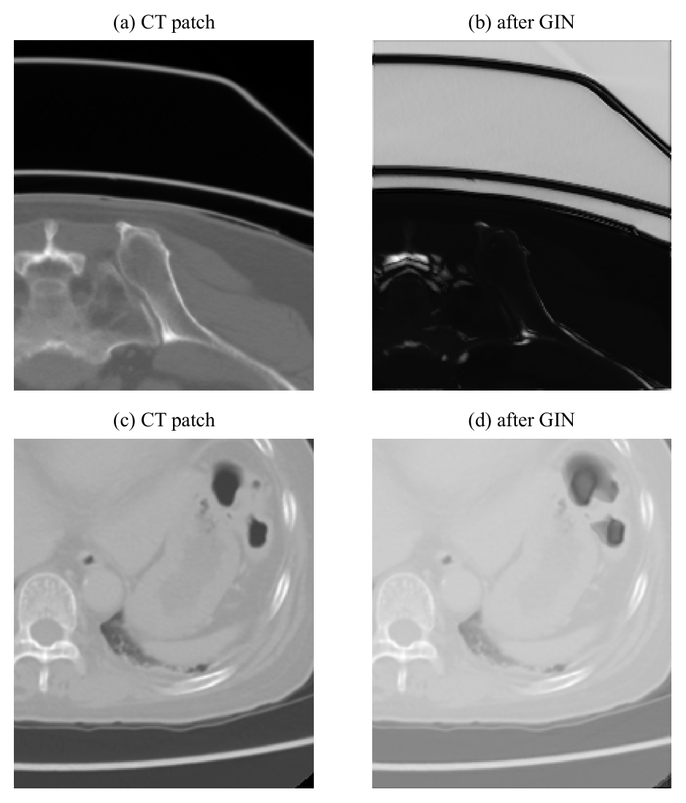

# Method

[Back to the overview](../README.md) · [Results](RESULTS.md)

## The question

A model trained on labelled CT is applied to MRI, where it has no labels to
learn from. The project measures how large that CT to MRI gap is for 3D
abdominal organ segmentation, then tests two families of fixes on the same data
and the same network:

* **Part A, unsupervised adaptation:** start from a trained CT model and adapt
  it with unlabelled MRI (TENT, class balanced self training).
* **Part B, single source domain generalization:** change how the CT model is
  trained so that it does not depend on CT contrast (GIN), with no MRI at all.

## Data

| Set | Modality | Scans | Use |
|---|---|---|---|
| Source | CT | 150 | training of every model (120 train, 30 validation) |
| Adaptation | MRI | 40 | Part A only; no labels |
| Target test | MRI | 60 | final evaluation, read once; also the folds of the MRI reference model |
| External test | MRI | 100 | final evaluation of Part B (TotalSegmentator MRI) |

The source and target sets are AMOS with the CT to MRI split of the M3DA
benchmark. CT is labelled for 15 organs, but in the 60 test MRI the bladder and
prostate are labelled in only 2 scans. Every cross modality number is therefore
the mean over the 13 organs both modalities share: spleen, right kidney, left
kidney, gall bladder, esophagus, liver, stomach, aorta, inferior vena cava,
pancreas, right adrenal gland, left adrenal gland and duodenum. An organ is
scored on a scan only when that scan's ground truth contains it, so an absent
organ never counts as a zero.

## Preprocessing

All models share one frozen nnU-Net configuration (`3d_fullres`, nnU-Net
2.8.1):

* **Orientation.** AMOS CT headers are LAS and MRI headers are RAS. nnU-Net's
  default reader ignores the header, which would make CT and MRI mirror images
  of each other inside the network. Both datasets use nnU-Net's reorienting
  reader, and every volume's anatomy is checked (liver to the right of the
  spleen, right kidney to the right of the left kidney).
* **Normalization.** Both modalities are declared as one non CT channel, so
  each volume is normalized by its own mean and standard deviation instead of
  being clipped to a CT intensity window that means nothing for MRI.
* **Spacing.** nnU-Net's planner proposed 2.0 × 0.663 × 0.663 mm, which would
  have needed about 30 GB of disk for the preprocessed CT against roughly 20 GB
  available, and would have interpolated slices between the CT's native 5 mm
  ones. The spacing is fixed at 5.0 × 0.843 × 0.843 mm: native slice spacing,
  and the disk budget spent in plane. All 150 CT fit in 9.32 GB with none
  dropped. The patch is 40 × 224 × 192 voxels with a batch of 2.
* **Shared plans.** The MRI dataset uses the CT dataset's plans, so both
  modalities are resampled and normalized identically.

Getting this right took nine runs of the data preparation notebook. The
failures included the disk filling with full resolution label copies nnU-Net
makes after preprocessing (13.1 GB, avoided with links to the read only
labels), behaviour that had changed in nnU-Net 2.8.1 compared with older
releases, and the orientation problem above, which produced no error at all
and was caught only by the anatomy check.

## Network and training

nnU-Net's own 3D U-Net, trainer, loss (Dice plus cross entropy), default
augmentation and sliding window inference are used unchanged. Every model
trains on the same 120 CT and is validated on the same 30 CT, and the final
checkpoint is always the one evaluated. A run whose CT validation Dice falls
below 0.60 is reported as unhealthy and excluded from every verdict; every
trained model passed its health check.

## Part A: adaptation after training

**TENT** (Wang et al., 2021) minimizes the entropy of the model's own
predictions on unlabelled target data and updates only the affine parameters
of the normalization layers. nnU-Net uses instance normalization, so there are
no running statistics to estimate again; what remains is entropy minimization
over every normalization weight and bias. Settings follow the paper: Adam,
learning rate scaled from the paper's 0.001 at batch 128 to 0.000015625 at
nnU-Net's batch of 2, one pass over every sliding window tile of the 40 MRI. A collapse check
compares the area predicted as foreground before and after adaptation.

**Class balanced self training** (Zou et al., 2018) has the CT model (the
teacher) predict the 40 MRI. For each organ separately, the most confident half
of its voxels are kept as pseudo labels, plus any voxel at or above 0.9
confidence; everything else is ignored by the loss. A fresh student trains on
the 120 CT plus the 40 pseudo labelled MRI, identical to the teacher in every
other way. Before any student trains, the teacher must pass a gate fixed in
advance: it has to find the spleen, both kidneys and the liver in at least half
of the 40 MRI. A teacher that cannot is not seeing MRI anatomy, and training on
its output would be training on noise.

## Part B: GIN

GIN (global intensity nonlinear augmentation, Ouyang et al., 2023), in the form
DG-TTA runs inside nnU-Net, is applied to every training batch after nnU-Net's
own augmentation and before the forward pass. Each image goes through a freshly
drawn random shallow network:

* 4 convolution layers with 2 channels between them, kernel size 1 or 3 drawn
  per layer
* weights and biases drawn from a standard normal, independently per image
* leaky ReLU between layers
* the output blended with the original image by a random factor, then
  rescaled to the original image's norm

The weights are never learned, and GIN is never applied at validation or
inference: the trained model is an ordinary nnU-Net model.

The comparison has two arms that differ only in GIN, each trained three times
for 600 epochs: **plain** and **GIN**. Matching the epochs matters, because a
longer schedule alone raises MRI scores (from 0.167 at 100 epochs to 0.268 at
600 for plain).

## External test set

TotalSegmentator MRI (616 scans) was added because GIN had been chosen from a
benchmark that used the same 60 AMOS test MRI, so a gain measured only there
could be inflated by that choice. Its 13 structures that match the AMOS organs
were mapped to AMOS label numbers. A scan qualified if its ground truth
contains the liver, the spleen and both kidneys and its recorded source is not
AMOS: 183 qualified, and 100 were drawn with a fixed seed. Where two structures
claimed the same voxel the lower AMOS label was kept. All of this was fixed
before any model predicted an external scan. Because the two datasets define
their labels differently, only the difference between the arms on the same
scans is interpreted, never the absolute score.

## Evaluation and statistics

Every model is scored with nnU-Net's own predictor and evaluation (final
checkpoint, test time mirroring) on the 60 AMOS test MRI and, for Part B, on
the external 100. The rules were committed before any Phase 11 model existed:

| Rule | Value |
|---|---|
| Effect | difference of arm means over three runs, Welch 95% interval |
| Usefulness bar | a gain of at least 0.10 Dice with the interval above zero |
| CT margin | GIN may lose at most 0.03 Dice on CT |
| Health floor | a run below 0.60 CT Dice is not scored |
| Overall verdict | GIN must help on AMOS **and** on the external set, within the CT margin |

Before reading any MRI, the evaluation session predicted CT validation scans
again and compared them with the Dice nnU-Net recorded during training (largest
difference 0.00088), so the evaluation reproduces nnU-Net's own numbers.

## Engineering

* **Pause and resume.** A 600 epoch run takes about 35 hours on a T4, and a
  session stops after 12. The trainer was extended to check before each epoch,
  and before the final validation, whether it still fits the session's budget;
  if not, it saves a checkpoint with the true epoch count and exits with a
  dedicated code. The next session resumes through nnU-Net's own continue
  option. A test against the real nnU-Net code checks that no epoch is
  repeated or skipped.
* **Paired GPUs.** A plain run and its GIN twin trained side by side on the two
  GPUs of each session. A two epoch trial measured 221 seconds per epoch with
  both running, no slower than one alone.
* **Integrity.** Each session exported its runs with a manifest of SHA256
  hashes, and the next session verified every hash and refused an archive from
  an older session. Each session also recorded a hash of the GIN code and the
  trainer it ran.
* **Testing.** Every rule lives in a Python module with its own self test, and
  each GPU notebook is generated from those modules and executed offline
  against fixtures with planted answers before it runs on a GPU.

Copyright 2026 Abu Ahmad. All rights reserved.
