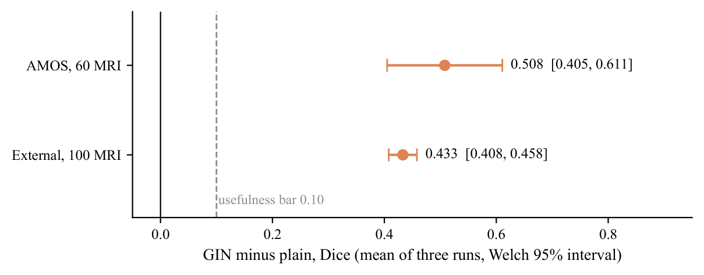
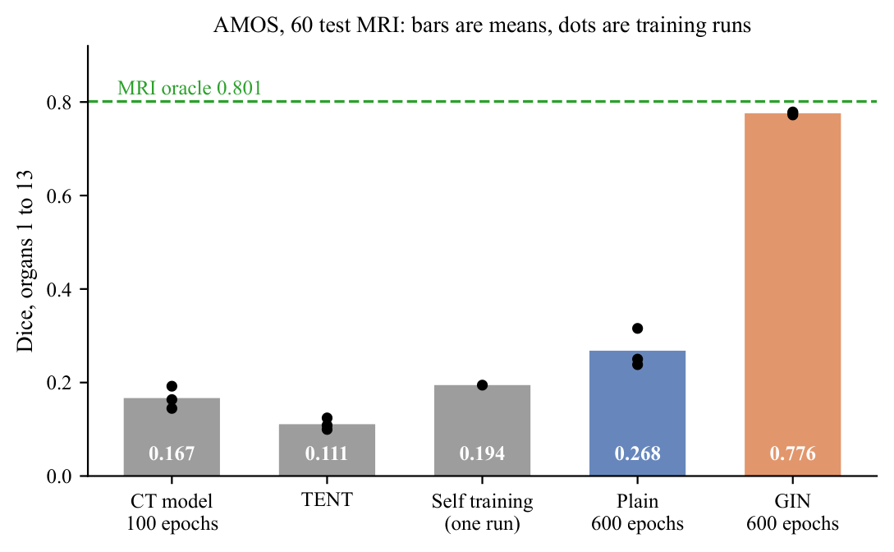
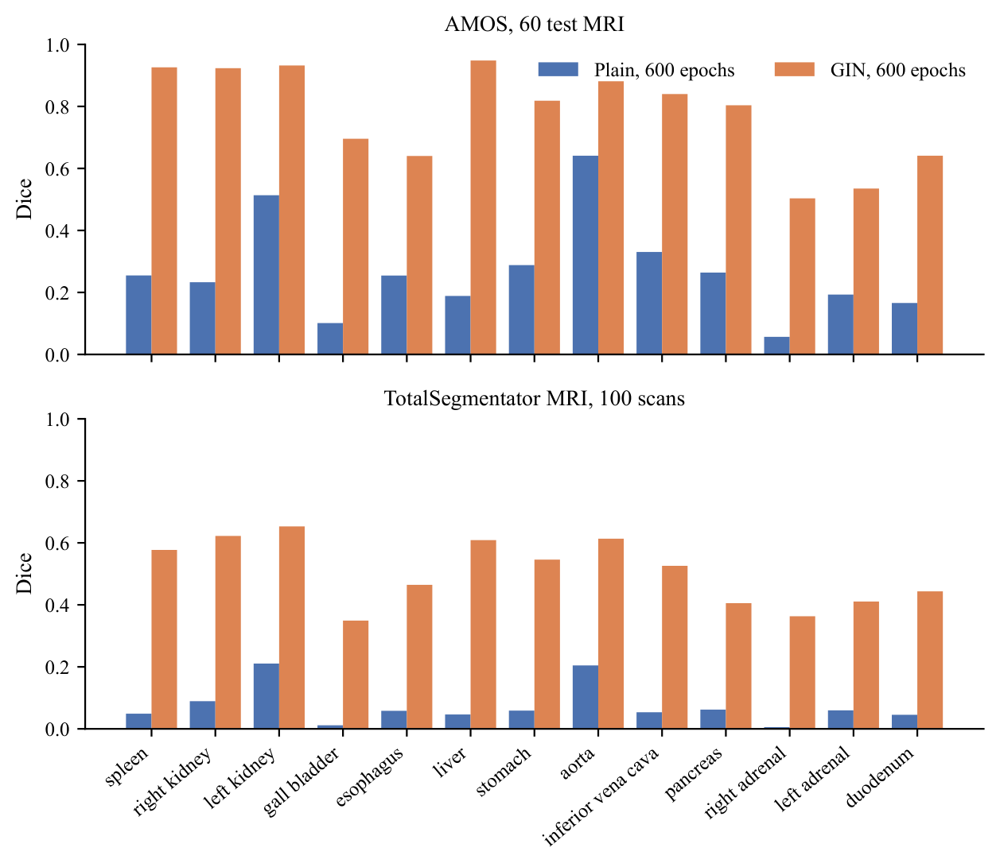
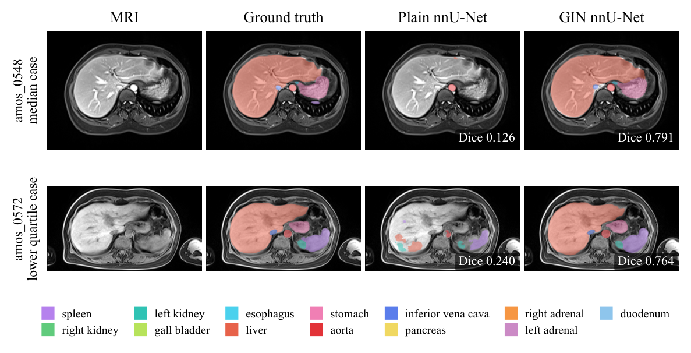
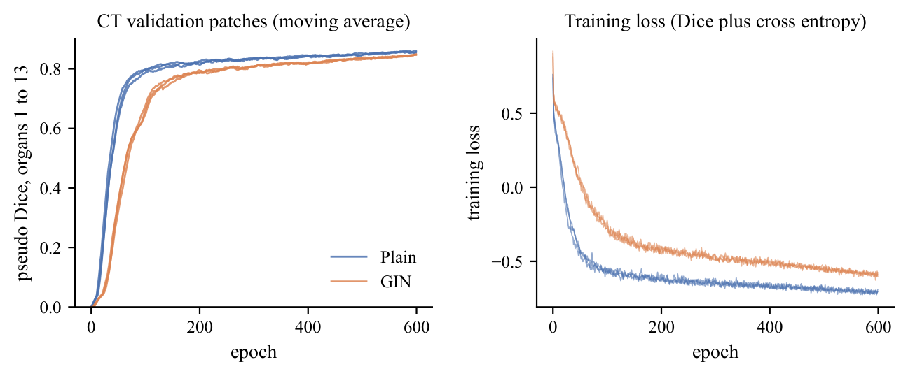

# Results

[Back to the overview](../README.md) · [Method](METHOD.md)

All numbers are mean Dice over the 13 organs both CT and MRI annotate, scored on
a scan only where that scan's ground truth contains the organ.

## The size of the gap

| Model | AMOS, 60 test MRI | CT validation |
|---|---|---|
| nnU-Net on CT, 100 epochs, run 1 | 0.1922 | 0.8238 |
| nnU-Net on CT, 100 epochs, run 2 | 0.1447 | 0.8267 |
| nnU-Net on CT, 100 epochs, run 3 | 0.1635 | 0.8256 |
| **Mean of the three CT models** | **0.1668** | 0.8254 |
| nnU-Net on labelled MRI, three folds pooled (reference) | **0.8012** | |

The gap is **0.634 Dice**. The three CT models agree within 0.003 on CT but
spread by 0.048 on MRI, so a single CT model says little about how it will do
on MRI.

## Part A: adaptation after training

| Method | Run 1 | Run 2 | Run 3 | Change against its own CT model |
|---|---|---|---|---|
| TENT | 0.1243 | 0.0997 | 0.1085 | 0.068, 0.045 and 0.055 lower |
| Class balanced self training | 0.1945 | not trained | not trained | 0.002 higher (95% interval 0.019 lower to 0.021 higher) |

* **TENT hurt in every repeat.** In each repeat the paired 95% interval lies
  below zero and TENT lost on all 60 test scans, and averaged over the repeats it
  scored below the CT models on all 13 organs. In one repeat the area it marked
  as organ on the 40 MRI shrank to 56% of the original model's.
* **Self training made no measurable difference.** The teachers of runs 2 and
  3 found the right kidney in only 15 of the 40 MRI, below the gate of half, so
  their students were never trained, as the rule required. The one student
  changed MRI Dice by +0.002 and lost 0.024 on CT.

## Part B: GIN against plain

### Every run

| Run | CT validation | AMOS, 60 MRI | External, 100 MRI | AMOS right kidney found |
|---|---|---|---|---|
| plain, run 1 | 0.8504 | 0.3158 | 0.0847 | 41 of 60 |
| plain, run 2 | 0.8498 | 0.2383 | 0.0603 | 48 of 60 |
| plain, run 3 | 0.8516 | 0.2501 | 0.0753 | 31 of 60 |
| GIN, run 1 | 0.8444 | 0.7768 | 0.5061 | 60 of 60 |
| GIN, run 2 | 0.8460 | 0.7787 | 0.5136 | 60 of 60 |
| GIN, run 3 | 0.8439 | 0.7725 | 0.4995 | 60 of 60 |

### The verdict

| Test | Plain | GIN | GIN minus plain (Welch 95%) | Rule | Outcome |
|---|---|---|---|---|---|
| AMOS, 60 MRI | 0.2681 | 0.7760 | +0.5079 (0.4050 to 0.6108) | gain at least 0.10, interval above 0 | GIN helps |
| External, 100 MRI | 0.0734 | 0.5064 | +0.4330 (0.4078 to 0.4582) | gain at least 0.10, interval above 0 | GIN helps |
| CT validation | 0.8506 | 0.8448 | 0.0058 lower | lose at most 0.03 | within margin |

**Overall: `DG_CONFIRMED`.** GIN's gain equals 80% of the 0.634 gap, and GIN
ends 0.025 below the nnU-Net trained on labelled MRI.

### Per organ

Mean of three runs per arm. On AMOS every organ is present in all 60 scans
except the spleen (59) and the gall bladder (55).

| Organ | AMOS plain | AMOS GIN | External plain | External GIN |
|---|---|---|---|---|
| Spleen | 0.255 | 0.926 | 0.049 | 0.577 |
| Right kidney | 0.233 | 0.923 | 0.089 | 0.622 |
| Left kidney | 0.513 | 0.932 | 0.211 | 0.653 |
| Gall bladder | 0.101 | 0.696 | 0.012 | 0.349 |
| Esophagus | 0.255 | 0.640 | 0.058 | 0.465 |
| Liver | 0.189 | 0.948 | 0.046 | 0.609 |
| Stomach | 0.288 | 0.818 | 0.059 | 0.546 |
| Aorta | 0.641 | 0.881 | 0.205 | 0.613 |
| Inferior vena cava | 0.331 | 0.840 | 0.053 | 0.526 |
| Pancreas | 0.264 | 0.804 | 0.062 | 0.405 |
| Right adrenal gland | 0.057 | 0.503 | 0.006 | 0.363 |
| Left adrenal gland | 0.193 | 0.535 | 0.060 | 0.411 |
| Duodenum | 0.166 | 0.641 | 0.045 | 0.443 |

GIN is ahead on every organ in both sets. The large, high contrast organs
(liver, spleen, kidneys) reach 0.92 to 0.95 on AMOS; the small adrenal glands
stay near 0.5. Absolute scores on the external set are not compared with AMOS,
because the two datasets define their labels differently.

### Examples

Two of the 60 test MRI, chosen by a fixed rule (the lower median and the lower
quartile of one GIN run's case scores), not picked by eye.

### Training

GIN's training loss stays higher throughout, as expected when every training
image has a random contrast, while its CT validation score ends close to
plain's.

## Limitations

* The AMOS test set has 60 scans and the external set 100. On the external set
  GIN reaches 0.506, so the gap is far from closed on data from other sources.
* The 60 AMOS test MRI were also the test set of the benchmark that ranked GIN
  first; the external set exists to check that this did not inflate the result.
* One training recipe was tested: nnU-Net 2.8.1, one fixed spacing, 600 epochs.
* Dice is the only metric reported; surface distance metrics are future work.

Copyright 2026 Abu Ahmad. All rights reserved.
